# Отчёт по контрольной точке №1

## Тема

Написание простых Ansible Playbook для автоматизации установки, настройки и проверки сервисов на сервере Ubuntu.

## Цель работы

Освоить структуру Ansible-проекта, inventory, переменные групп и роли, а также автоматизировать типовые операции администрирования сервера.

## Среда выполнения

- ОС целевого сервера: Ubuntu Server 24.04;
- Python: 3.12.3;
- Ansible Core: 2.16.3;
- целевой узел: `server1`;
- каталог проекта: `/root/КТ-1`;
- подключение: SSH с ключом;
- репозиторий приложения: [github.com/valer1q/prilojeniye](https://github.com/valer1q/prilojeniye).

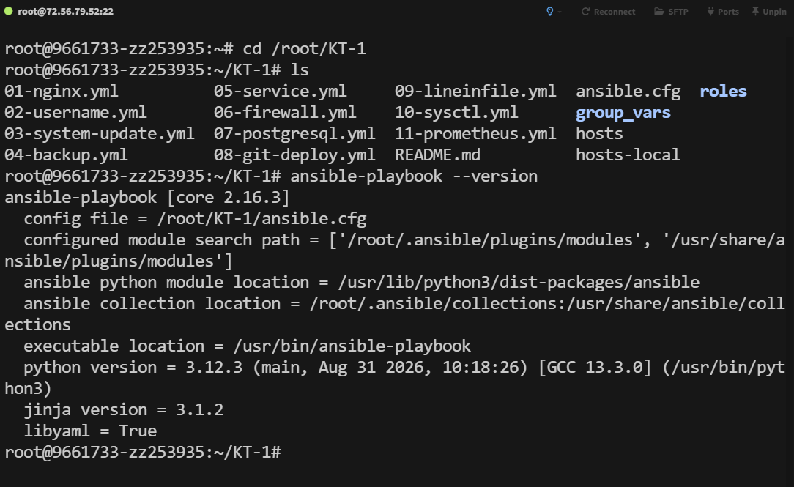

## Структура проекта

```text
КТ-1/
├── hosts
├── hosts-local
├── ansible.cfg
├── group_vars/web
├── roles/nginx/
├── 01-nginx.yml
├── 02-username.yml
├── 03-system-update.yml
├── 04-backup.yml
├── 05-service.yml
├── 06-firewall.yml
├── 07-postgresql.yml
├── 08-git-deploy.yml
├── 09-lineinfile.yml
├── 10-sysctl.yml
├── 11-prometheus.yml
└── demo-app/
```

Проверка доступности узла выполнена успешно: Ansible получил ответ `pong`.

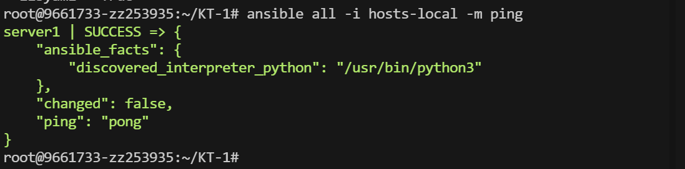

## Выполненные сценарии

### 1. Установка и настройка Nginx

Playbook `01-nginx.yml` установил пакет Nginx, запустил службу и включил её автозапуск. Результат: `failed=0`.

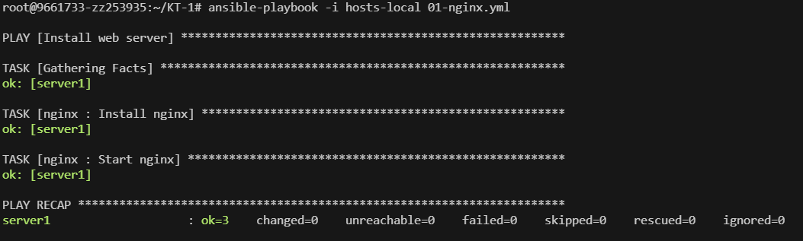

### 2. Управление пользователями

Playbook `02-username.yml` создал пользователя `newadmin` и добавил его в группы `root` и `sudo`. Результат: `failed=0`.

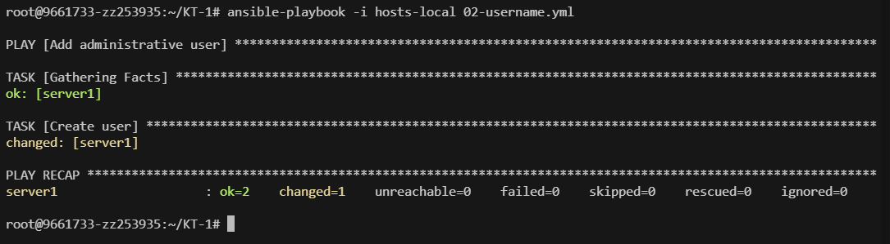

### 3. Обновление системы

Playbook `03-system-update.yml` обновил индекс пакетов и установленные пакеты. После выполнения Playbook сервер был перезагружен вручную командой `reboot`, так как при локальном соединении Ansible защищает control node от перезагрузки.

### 4. Резервное копирование конфигураций

Playbook `04-backup.yml` создал каталог `/var/backups/configuration`, скопировал `/etc/hosts` и `/etc/ssh/sshd_config`, затем собрал архив `/var/backups/configuration.tar.gz`. Результат: `failed=0`.

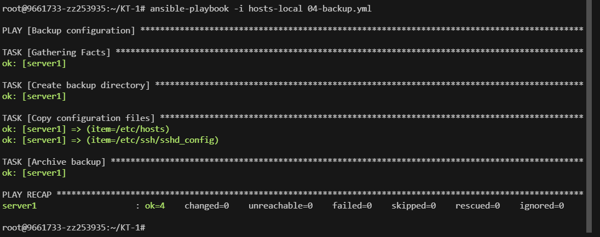

### 5. Управление сервисом

Playbook `05-service.yml` обеспечил запущенное состояние Nginx и включил автозапуск. Результат: `failed=0`.

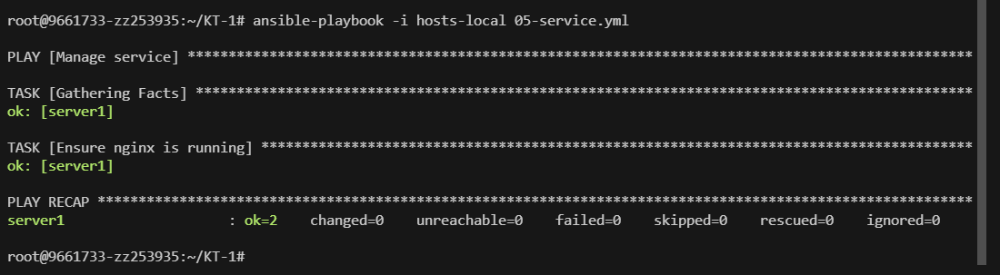

### 6. Настройка файрвола

Playbook `06-firewall.yml` установил UFW, разрешил SSH и HTTP, включил запрет входящих подключений по умолчанию. Результат: `failed=0`.

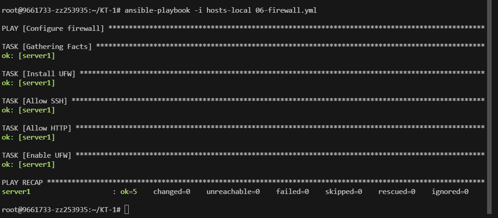

### 7. Установка PostgreSQL

Playbook `07-postgresql.yml` установил PostgreSQL и включил службу. Результат: `failed=0`.

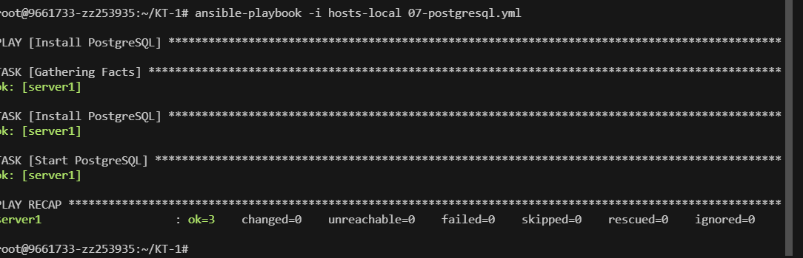

### 8. Деплой приложения из Git

В GitHub создано простое статическое приложение. Playbook `08-git-deploy.yml` клонировал репозиторий в `/opt/example-app` и опубликовал `index.html` через Nginx. Результат: `failed=0`.

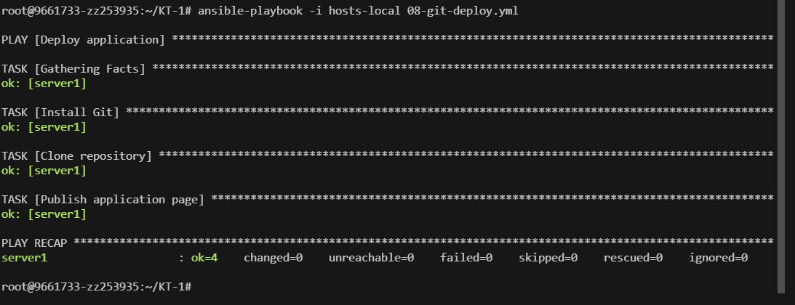

### 9. Замена строки в `index.html`

Playbook `09-lineinfile.yml` заменил заголовок страницы на `<h1>DevSecOps server</h1>` с использованием модуля `lineinfile`.

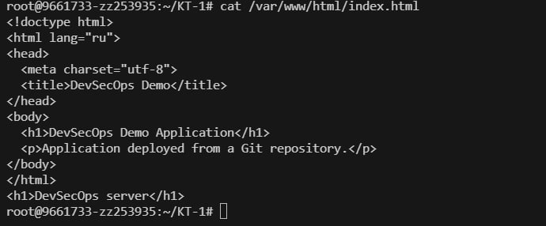

### 10. Настройка системных параметров

Playbook `10-sysctl.yml` установил значения `0` для `net.ipv4.ip_forward` и `net.ipv4.conf.all.accept_redirects`.

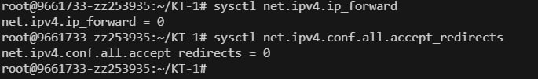

### 11. Мониторинг ресурсов

Playbook `11-prometheus.yml` установил Prometheus и включил службу. Результат: `failed=0`.

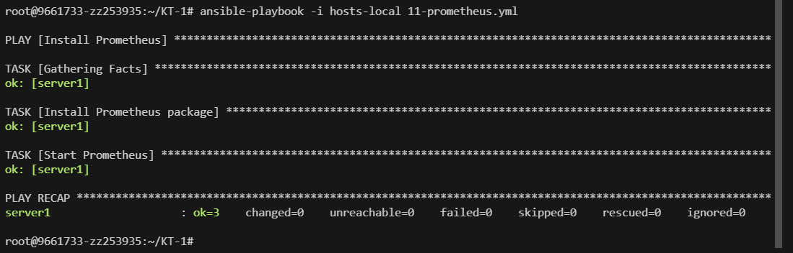

## Итоговая проверка

На сервере проверены состояния Nginx, PostgreSQL и Prometheus — все службы находятся в состоянии `active`. Пользователь `newadmin` создан, UFW активен, резервный архив существует, приложение отдаётся веб-сервером.

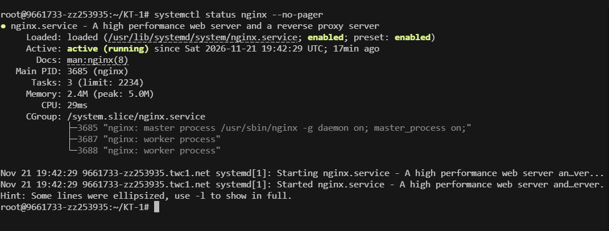

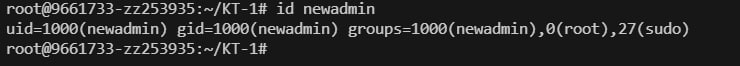

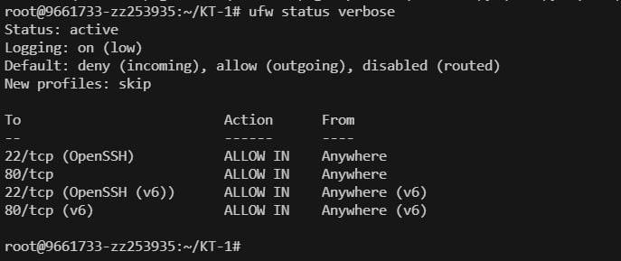

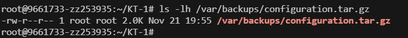

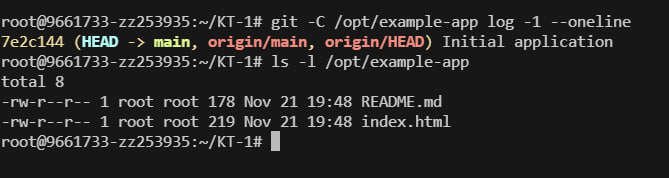

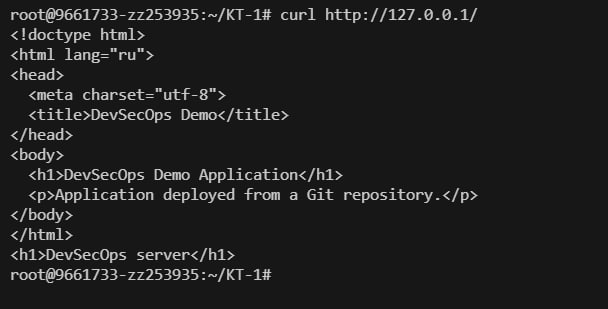

## Вывод

В ходе работы создан Ansible-проект с inventory, переменными группы и ролью Nginx. Playbook автоматизируют установку веб-сервера, управление пользователями и службами, обновление системы, резервное копирование, настройку UFW и sysctl, установку PostgreSQL и Prometheus, а также деплой приложения из Git.
