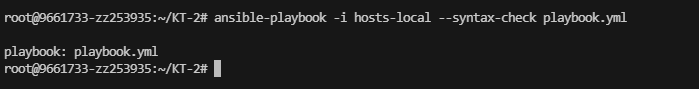
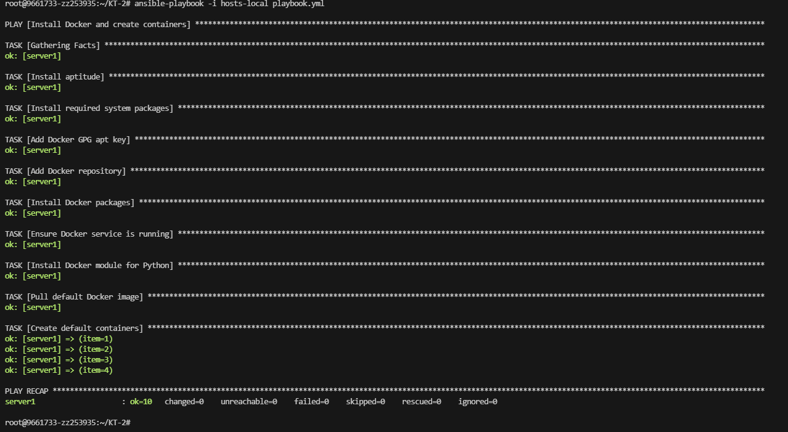
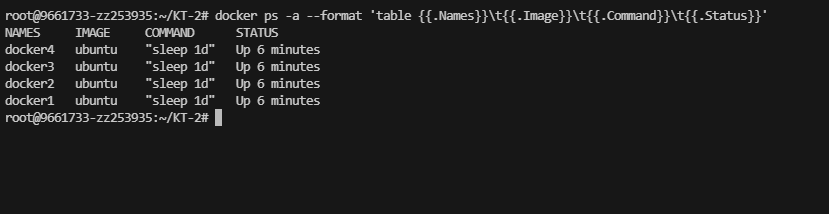
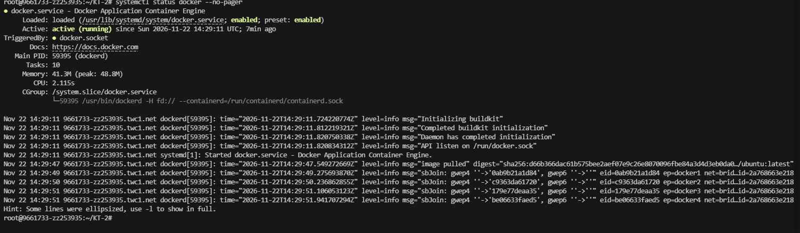
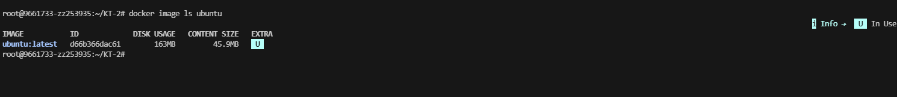

# Отчёт по контрольной точке №2

## Тема

Установка Docker и создание контейнеров с помощью Ansible Playbook.

## Цель работы

Автоматизировать установку Docker, загрузку образа Ubuntu и создание четырёх контейнеров с одинаковыми параметрами.

## Среда выполнения

- Ubuntu Server 24.04;
- Ansible Core 2.16.3;
- Docker Engine;
- образ `ubuntu:latest`;
- каталог проекта: `/root/КТ-2`.

## Состав проекта

- `hosts` — inventory;
- `hosts-local` — локальный inventory для запуска на control node;
- `ansible.cfg` — настройки Ansible;
- `playbook.yml` — основной Playbook;
- `README.md` — инструкции запуска и проверки;
- `report/` — скриншоты выполнения.

## Выполненные действия

`playbook.yml` устанавливает aptitude и системные зависимости, добавляет ключ и официальный репозиторий Docker, устанавливает Docker Engine, запускает службу, устанавливает Python-модуль Docker, загружает образ `ubuntu` и создаёт четыре контейнера `docker1`–`docker4` с командой `sleep 1d`.

## Проверка синтаксиса

```bash
ansible-playbook -i hosts-local --syntax-check playbook.yml
```

Результат: `playbook: playbook.yml`.



## Запуск Playbook

```bash
ansible-playbook -i hosts-local playbook.yml
```

Итоговый результат: `ok=10 changed=0 unreachable=0 failed=0`.



## Проверка контейнеров

```bash
docker ps -a --format 'table {{.Names}}\t{{.Image}}\t{{.Command}}\t{{.Status}}'
```

Созданы и запущены четыре контейнера на основе `ubuntu` с командой `sleep 1d`.



## Проверка службы Docker

Служба Docker имеет состояние `active (running)` и включённый автозапуск.



## Проверка образа

Образ `ubuntu:latest` загружен локально и используется контейнерами.



## Вывод

Playbook успешно устанавливает Docker, загружает образ Ubuntu и создаёт четыре работающих контейнера с заданными именами и командой запуска. Ошибок выполнения нет: `failed=0`, `unreachable=0`.
