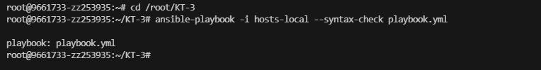
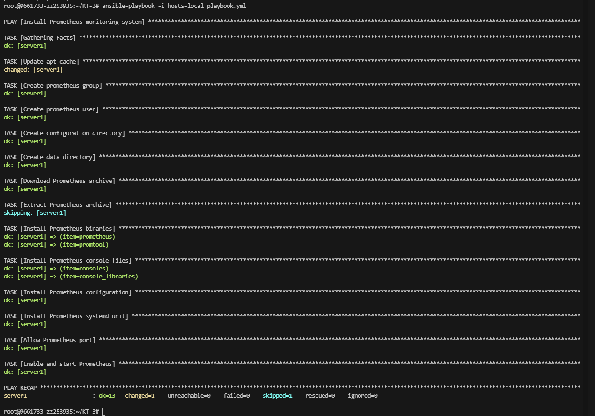
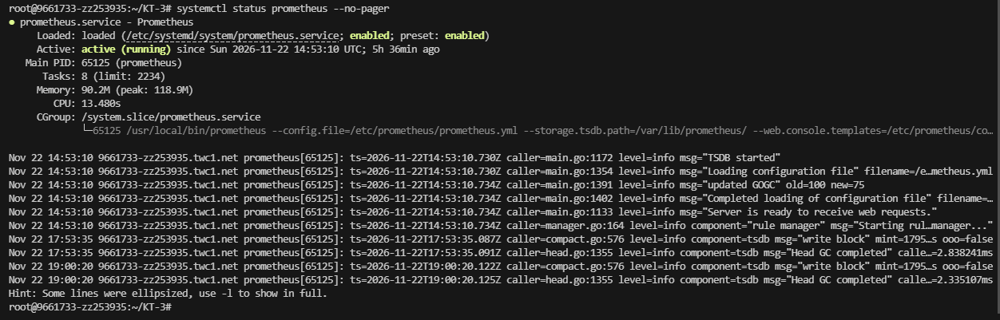
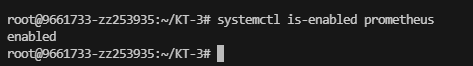
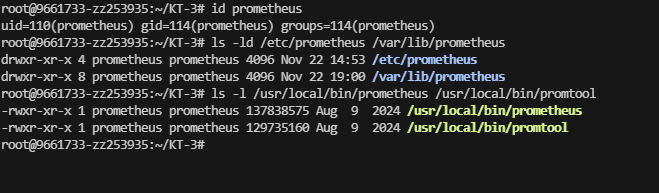
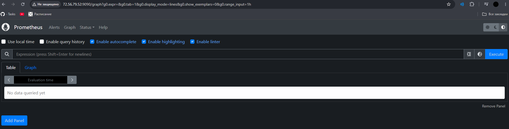

# Отчёт по контрольной точке №3

## Тема

Установка и настройка системы мониторинга Prometheus.

## Среда выполнения

- Ubuntu Server 24.04;
- Ansible Core 2.16.3;
- Prometheus 2.53.2;
- сервер: `72.56.79.52`;
- каталог проекта: `/root/КТ-3`.

## Выполненные действия

Playbook `playbook.yml` обновляет индекс пакетов, создаёт системную группу и пользователя `prometheus`, создаёт каталоги `/etc/prometheus` и `/var/lib/prometheus`, скачивает и распаковывает официальный архив Prometheus 2.53.2, устанавливает бинарные файлы и конфигурацию, создаёт systemd-службу, открывает порт 9090 в UFW и включает автозапуск.

## Проверка синтаксиса

```bash
ansible-playbook -i hosts-local --syntax-check playbook.yml
```



## Запуск Playbook

```bash
ansible-playbook -i hosts-local playbook.yml
```

Итоговый результат:

```text
ok=13 changed=1 unreachable=0 failed=0 skipped=1
```



## Проверка службы

```bash
systemctl status prometheus --no-pager
systemctl is-enabled prometheus
```

Служба находится в состоянии `active (running)`, автозапуск имеет значение `enabled`.





## Проверка готовности и файлов

```bash
curl -fsS http://127.0.0.1:9090/-/ready
id prometheus
ls -ld /etc/prometheus /var/lib/prometheus
ls -l /usr/local/bin/prometheus /usr/local/bin/promtool
```

Endpoint вернул `Prometheus Server is Ready.`. Пользователь, каталоги и бинарные файлы присутствуют.




## Веб-интерфейс и порт

Порт 9090 разрешён в UFW, а веб-интерфейс доступен по адресу `http://72.56.79.52:9090`.



## Вывод

Prometheus установлен из официального архива, настроен как systemd-служба, включён в автозагрузку и доступен через веб-интерфейс на порту 9090. Playbook выполнен без ошибок.
