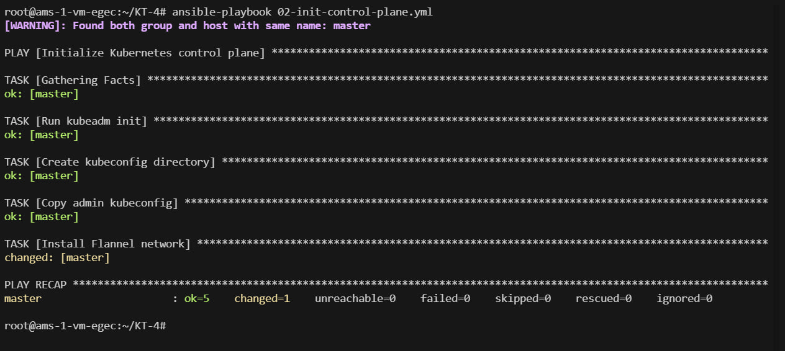
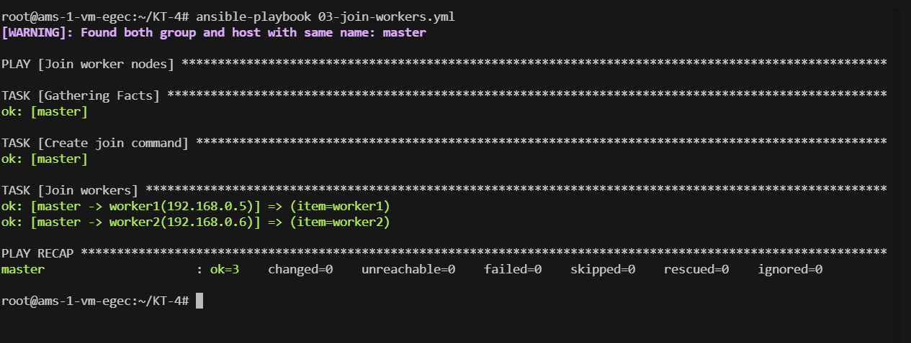
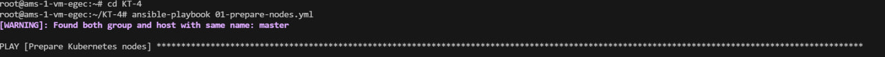
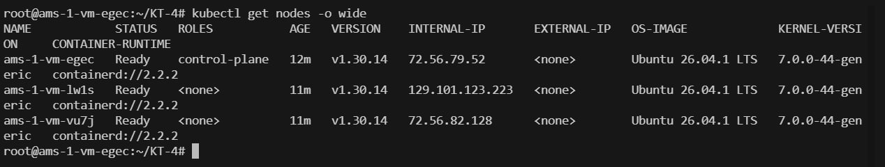
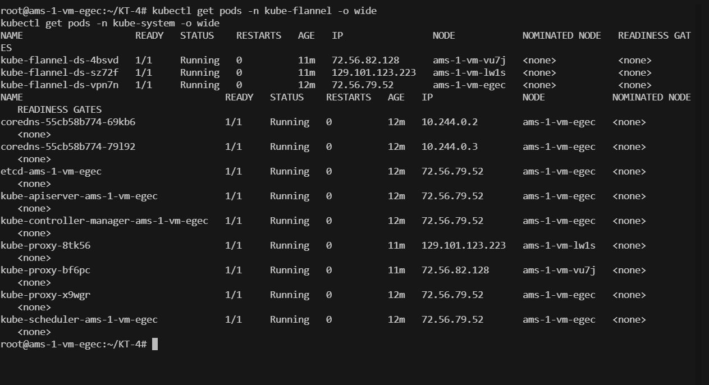
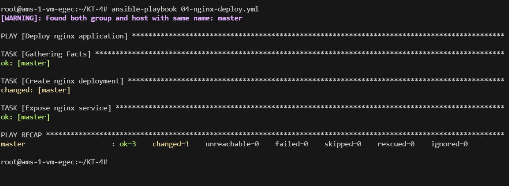
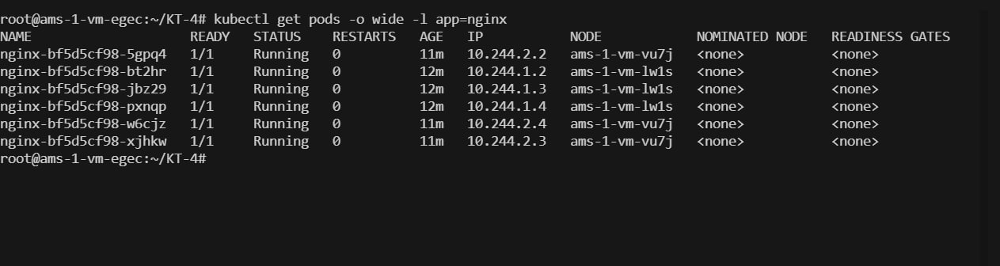
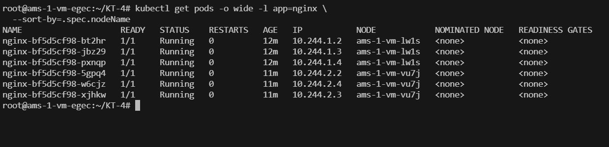
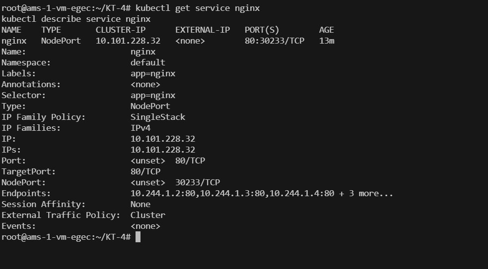
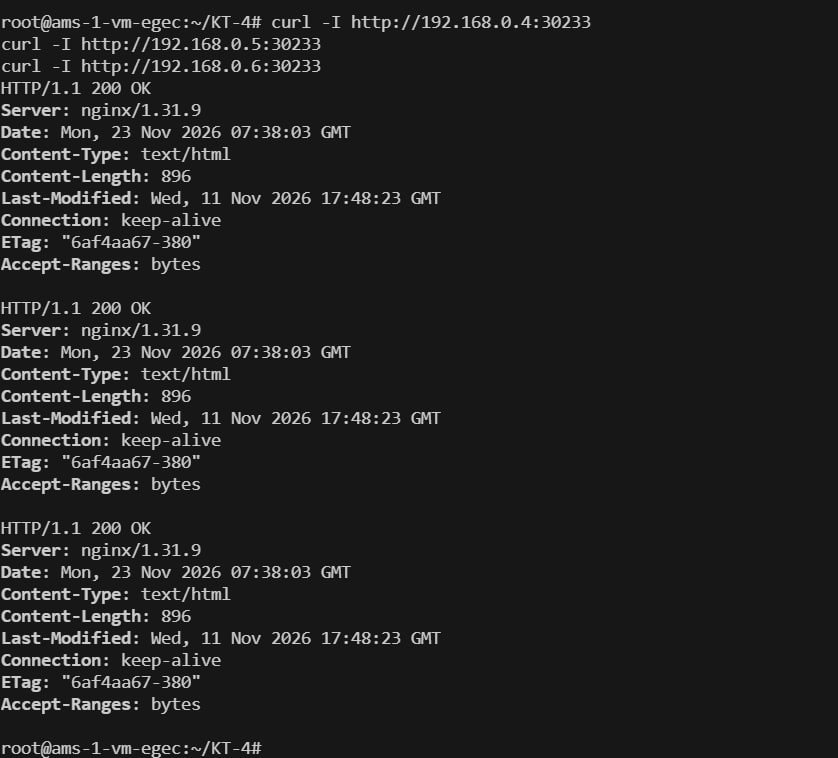

# Отчёт по контрольной точке №4

## Тема

Развёртывание Kubernetes-кластера и запуск приложения nginx.

## Цель работы

Подготовить несколько узлов, установить компоненты Kubernetes, объединить серверы в кластер и развернуть реплицированное приложение с сетевым сервисом.

## Среда выполнения

| Роль | Внутренний адрес | Публичный адрес |
|---|---|---|
| Master | `192.168.0.4` | `72.56.79.52` |
| Worker 1 | `192.168.0.5` | `129.101.123.223` |
| Worker 2 | `192.168.0.6` | `72.56.82.128` |

Операционная система узлов — Ubuntu 26.04.1 LTS. Использованы `containerd`, `kubeadm`, `kubelet`, `kubectl` версии Kubernetes `1.30.14` и сетевой плагин Flannel.

## Структура проекта

```text
КТ-4/
├── hosts
├── ansible.cfg
├── 01-prepare-nodes.yml
├── 02-init-control-plane.yml
├── 03-join-workers.yml
├── 04-nginx-deploy.yml
├── README.md
└── report/
```

## Подготовка узлов

Playbook `01-prepare-nodes.yml` выполнен на master и двух worker-нодах. Он отключает swap, загружает модули `overlay` и `br_netfilter`, применяет параметры сетевого стека, устанавливает containerd, включает systemd cgroup driver, добавляет репозиторий Kubernetes и устанавливает kubeadm, kubelet и kubectl.

Результат:

```text
master  ok=19 changed=14 failed=0
worker1 ok=19 changed=14 failed=0
worker2 ok=19 changed=14 failed=0
```



## Инициализация control plane

На master выполнен `kubeadm init` с адресом API-сервера `192.168.0.4` и сетью pod `10.244.0.0/16`. После инициализации настроен kubeconfig для root и установлен Flannel.

```bash
ansible-playbook 02-init-control-plane.yml
```

Результат:

```text
master ok=5 changed=4 failed=0
```



## Подключение worker-нод

Worker-ноды подключены к control plane с помощью команды `kubeadm token create --print-join-command`.

```bash
ansible-playbook 03-join-workers.yml
```

Обе ноды присоединились без ошибок.



## Проверка кластера

```bash
kubectl get nodes -o wide
```

В кластере присутствуют три узла. Все имеют статус `Ready`: master и два worker.



Системные pod’ы Flannel, CoreDNS и kube-proxy также перешли в состояние `Running`.



## Развёртывание nginx

Playbook `04-nginx-deploy.yml` создаёт Deployment nginx с шестью репликами и публикует его через сервис типа NodePort.

```bash
ansible-playbook 04-nginx-deploy.yml
```

Результат выполнения:

```text
master ok=3 changed=1 failed=0
```



## Проверка pod’ов nginx

```bash
kubectl get pods -o wide -l app=nginx
```

Созданы шесть pod’ов, все находятся в состоянии `Running`. Pod’ы распределены между worker-нодами.





## Проверка сервиса

```bash
kubectl get service nginx
kubectl describe service nginx
```

Создан сервис:

```text
TYPE: NodePort
PORT: 80:30233/TCP
```



Проверка доступности через NodePort:

```bash
curl http://192.168.0.4:30233
curl http://192.168.0.5:30233
curl http://192.168.0.6:30233
```



## Итог

Создан Kubernetes-кластер из трёх узлов: одного control plane и двух worker-нод. Все узлы находятся в состоянии `Ready`. Сетевой плагин Flannel и системные компоненты работают. В кластере развёрнут nginx с шестью репликами, pod’ы запущены на worker-нодах, а доступ к приложению предоставлен через сервис NodePort на порту `30233`.

В исходном учебном материале использовался Kubernetes `0.17.0` с устаревшими командами `run-container`, `Replication Controller` и `minions`. На Ubuntu 26.04 эти компоненты несовместимы, поэтому применена современная эквивалентная схема `kubeadm`, `Deployment`, `Pod` и `Service`, сохраняющая требуемый результат задания.
